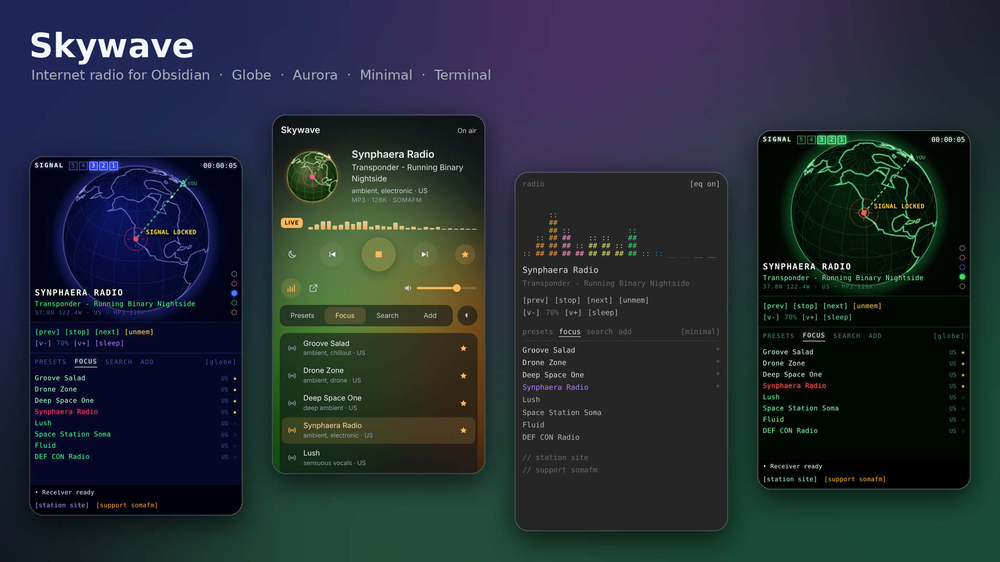

# Skywave

*Skywave was called Hi-Fi Tuner before version 1.8.0. The plugin ID is unchanged, so your settings and presets carry over.*

Listen to internet radio in your Obsidian sidebar, on a wireframe globe, in a minimal text view or in the soft Aurora look.

The default **globe** view plots stations on a wireframe world map. When you tune in, the globe turns to face the station and draws a signal arc from your rough location. Your location comes from your time zone, never GPS. For something calmer, switch to the **minimal** text view, or to the **Aurora** look: soft glass panels, SomaFM's station artwork and slowly drifting glows. With [Aurora Clock](https://github.com/AshOtis/Aurora-Clock) installed, the glows follow the time of day; without it, they're northern-lights green and violet. In the Aurora look the radio leaves the Static Aurora theme to Aurora Clock too, so the player and your theme always match, unless you turn on **Colours from the station name** (the default), in which case each station colours the glows and the theme itself.

## What's new in 1.8.0

- **New name:** Hi-Fi Tuner is now **Skywave**.
- **One look button:** a single button at the right end of the tab row switches between the looks and shows the one you're on: **[globe]**, **[aurora]** or **[minimal]**. Click it to cycle Globe, Aurora, Minimal. It sits in the same place in every look, so the look and colour choices no longer live in settings.
- **Globe colours on the globe:** on the globe look, five small dots at the bottom right of the globe (they fade in when you move the mouse over it) pick the colour way: Black and white, Aurora, Blue, Terminal and Brown.
- **The globe in the Aurora look:** a small globe now takes the place of the station artwork, floating on the background in the glow colours, turning to face the playing station and pulsing with the level meter. Turn it off with **Globe in the artwork tile** to get the station's own artwork back.
- **Station colours:** the Aurora look's glows, the globe and the Static Aurora theme take their colours from the name of the station that is playing, the same colours every time. Each letter A–Z becomes a value from 0 to 255 (A is 0, M is about 122, Z is 255) and the letters are read in threes as red, green and blue. Turn it off with **Colours from the station name** to follow the time of day with Aurora Clock instead.
- **EQ fix:** switching the EQ on while a station is playing now takes effect straight away, instead of waiting until you tune to another station.

## Features

- **Focus:** hand-picked stations for working, from SomaFM, Radio Paradise and NTS, with now-playing info for SomaFM.
- **Search:** about 50,000 stations from the open Radio Browser directory, by name or #genre, mapped by location.
- **Add URL:** play any direct stream (MP3, AAC or Ogg).
- **Presets:** **[mem]** stores the current station, or click **+** on any list. There are commands for presets 1–6.
- **Sleep timer** and an ASCII EQ (it needs a stream that allows it; SomaFM does).
- **Globe colours:** five colour ways for the globe look: Blue (classic), Brown, Terminal (green on black), Aurora (rose and violet) and Black and white (soft greys and off-white, for monochrome themes). Pick one with the coloured dots at the bottom right of the globe.
- **Static Aurora theme:** with the [Static Aurora](https://github.com/AshOtis/aurora-theme) theme installed, the theme glows in the same colours as your chosen globe colour way when you press play. Turn this off with **Colour the Static Aurora theme**.
- **Takes turns:** pressing play pauses my other players (Static FM, Aurora MP3), and they stop Skywave. Turn on **Play alongside other players** to mix them.
- **Status bar** now-playing, media keys, and commands for everything. Set your own hotkeys in **Settings → Hotkeys**.

## Usage

Click the radio icon in the left ribbon, or run **Skywave: Open tuner** from the command palette. Then pick a station from the list, or click a blip on the globe.

## Network use

Skywave is a radio, so it needs the internet. It connects to:

- `api.somafm.com` for SomaFM's channel list, playlists and now-playing info, and SomaFM's station artwork in the Aurora look.
- `cdn.jsdelivr.net` for the Natural Earth coastline outline (world-atlas, public domain), once per session. This is map data, not code.
- `*.api.radio-browser.info` for station search. When you play a station you found there, it also hits the directory's anonymous click counter.
- The radio streams you choose to play.

There's no telemetry and no account. Presets and settings are stored in the plugin's `data.json` in your vault.

## Desktop only

Marked desktop only, because background audio on mobile is unreliable.

## Support

Stations are listener-supported. If you enjoy one, consider supporting it (SomaFM: https://somafm.com/support/).

If you like the plugin, you can [buy me a coffee](https://buymeacoffee.com/ashotis). Found a bug or have an idea? [Open an issue](https://github.com/AshOtis/hifi-tuner/issues). It's the best way to reach me, and every report gets read.

## Building from source

There are no dependencies. Run `python3 build.py` to write `main.js`, `styles.css` and `manifest.json` to `dist/`.

## License

- Code: [GNU AGPL v3 or later](LICENSE) © AshOtis
- Font: uses [IBM Plex Mono](https://github.com/IBM/plex) if it's installed on your computer, otherwise your Obsidian monospace font
- Map data: Natural Earth, public domain
