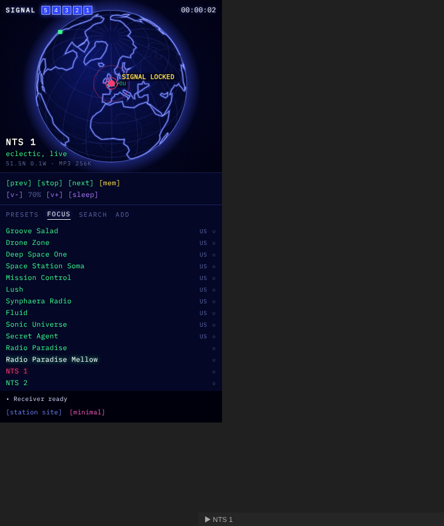

# Hi-Fi Tuner

Listen to internet radio in your Obsidian sidebar, on a wireframe globe, in a minimal text view or in the soft Aurora look.

The default **globe** view plots stations on a wireframe world map. When you tune in, the globe turns to face the station and draws a signal arc from your rough location. Your location comes from your time zone, never GPS. For something calmer, switch to the **minimal** text view, or to the **Aurora** look: soft glass panels, SomaFM's station artwork and slowly drifting glows. With [Aurora Clock](https://github.com/AshOtis/Aurora-Clock) installed, the glows follow the time of day; without it, they're northern-lights green and violet. In the Aurora look the radio leaves the Static Aurora theme to Aurora Clock too, so the player and your theme always match.

## Features

- **Focus:** hand-picked stations for working, from SomaFM, Radio Paradise and NTS, with now-playing info for SomaFM.
- **Search:** about 50,000 stations from the open Radio Browser directory, by name or #genre, mapped by location.
- **Add URL:** play any direct stream (MP3, AAC or Ogg).
- **Presets:** **[mem]** stores the current station, or click **+** on any list. There are commands for presets 1–6.
- **Sleep timer** and an ASCII EQ.
- **Globe colours:** four colour ways for the globe look: Blue (classic), Brown, Terminal (green on black) and Aurora (rose and violet). Pick one in settings.
- **Static Aurora theme:** with the [Static Aurora](https://github.com/AshOtis/aurora-theme) theme installed, the theme glows in the same colours as your chosen globe colour way when you press play. Turn this off with **Colour the Static Aurora theme**.
- **Takes turns:** pressing play pauses my other players (Static FM, Aurora MP3), and they stop Hi-Fi Tuner. Turn on **Play alongside other players** to mix them.
- **Status bar** now-playing, media keys, and commands for everything. Set your own hotkeys in **Settings → Hotkeys**.

## Usage

Click the radio icon in the left ribbon, or run **Hi-Fi Tuner: Open tuner** from the command palette. Then pick a station from the list, or click a blip on the globe.

## Network use

Hi-Fi Tuner is a radio, so it needs the internet. It connects to:

- `api.somafm.com` for SomaFM's channel list, playlists and now-playing info, and SomaFM's station artwork in the Aurora look.
- `cdn.jsdelivr.net` for the Natural Earth coastline outline (world-atlas, public domain), once per session. This is map data, not code.
- `*.api.radio-browser.info` for station search. When you play a station you found there, it also hits the directory's anonymous click counter.
- The radio streams you choose to play.

There's no telemetry and no account. Presets and settings are stored in the plugin's `data.json` in your vault.

## Desktop only

Marked desktop only, because background audio on mobile is unreliable.

## Support

Stations are listener-supported. If you enjoy one, consider supporting it (SomaFM: https://somafm.com/support/).

If you like the plugin, you can [buy me a coffee](https://buymeacoffee.com/ashotis).

## Building from source

There are no dependencies. Run `python3 build.py` to write `main.js`, `styles.css` and `manifest.json` to `dist/`.

## License

- Code: [MIT](LICENSE) © AshOtis
- Font: uses [IBM Plex Mono](https://github.com/IBM/plex) if it's installed on your computer, otherwise your Obsidian monospace font
- Map data: Natural Earth, public domain
